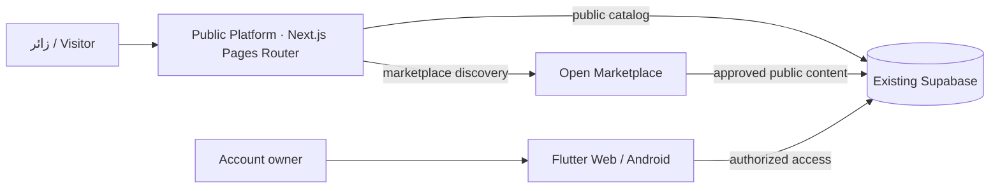

<div align="center">


# بيت الريف | Biet Al Reef
### منصة الأعمال والبناء والخدمات المحلية في دولة الإمارات
**UAE Construction, Business & Local Service Discovery Platform**

**Discover → Evaluate → Connect → Request**

[**المنصة العامة**](https://bietalreef.ae) · [**السوق المفتوح**](https://app.bietalreef.ae) · [**تطبيق ويب**](https://providers.bietalreef.ae) · [**Android**](https://play.google.com/store/apps/details?id=ae.bietalreef.app)


</div>

---

## 🇦🇪 نظرة عامة | Mission

**بيت الريف** منظومة رقمية تربط العملاء بالأعمال والخدمات ذات الصلة بالبناء والمقاولات والتصميم والصيانة ومواد البناء في الإمارات. تقوم **المنصة العامة** بالتعريف والاكتشاف المحلي وعرض المعلومات المؤهلة للنشر، بينما يوفر **السوق المفتوح** استكشاف المنتجات والخدمات، ويقدم **تطبيق الويب وAndroid** مساحة إدارة الحساب والأعمال وفق صلاحياتها.

> **حدود المسؤولية:** هذا المستودع خاص بموقع **bietalreef.ae** العام. السوق والتطبيق التشغيلي لهما مستودعات وإصدارات مستقلة. مصدر بيانات الهوية والصلاحيات هو Supabase القائم؛ لا تنشئ الواجهة قاعدة بيانات بديلة.

### مجالات الاكتشاف | Discovery sectors

| القطاع | الهدف |
| :--- | :--- |
| **الشركات والمؤسسات** | عرض الأنشطة التجارية وملفاتها المعتمدة |
| **الاستشاريون** | الاستشارات الهندسية والتصميم والخدمات المهنية |
| **المقاولون** | أعمال البناء والتجديد والتشطيبات |
| **الورش والحرفيون** | الأعمال الحرفية والصناعية والصيانة |
| **مواد البناء والموردون** | المواد والمنتجات والموردون والمتاجر |

هذه **تسميات عرض للمستخدم** وليست إعادة تسمية تلقائية لجداول قاعدة البيانات أو أنواع الحسابات. تبقى المسارات المنشورة مثل `/providers` والروابط الموثقة كما هي حفاظًا على التوافق والفهرسة.

## 🧭 منظومة بيت الريف | Product surfaces

| الخدمة | الاستخدام | الوجهة |
| :--- | :--- | :--- |
| **Platform** | اكتشاف الشركات والخدمات وملفات الأعمال والبحث المحلي | [bietalreef.ae](https://bietalreef.ae) |
| **Open Marketplace** | تصفح الكتالوج والخدمات والعروض العامة دون اشتراط تسجيل للتصفح | [app.bietalreef.ae](https://app.bietalreef.ae) |
| **Web & Android** | إدارة الحساب والملف والمشاريع والطلبات وفق الصلاحيات | [Web](https://providers.bietalreef.ae) · [Play Store](https://play.google.com/store/apps/details?id=ae.bietalreef.app) |

## 🏗️ الهندسة | Architecture



| Layer | Current implementation |
| :--- | :--- |
| Framework | **Next.js 14.2.35**, React 18, Pages Router |
| Rendering | Public pages with SSR / SSG / ISR as configured per route |
| Data | Existing Supabase and publication/authorization rules |
| Internationalization | Arabic RTL and English LTR routes |
| Current production host | **Vercel** — source branch `master` |
| Cloudflare target | **Separate staging** using verified OpenNext/Next.js compatibility; **not the live production site yet** |

### Source map

```text
pages/        Public routes, locality/service pages and API handlers
components/   Navigation, search, profiles and content presentation
data/         UAE geography and domain taxonomy
lib/          Server-side data access and platform services
scripts/      Structural checks, local SEO tests and smoke tests
public/       Public brand assets, sitemap/robots-related assets
supabase/     Backend integration artifacts (production authority remains external)
```

## 🌍 Local Discovery · Al Ain pilot

The local-search experience connects **emirate → city/area → service → eligible business profile**. Initial validation includes Al Ain cleaning services and the real, approved service-provider coverage.

We preserve existing indexed URLs, canonical and `hreflang` relationships, visible content, structured data, internal links and sitemap eligibility during hosting migration. Publishing a provider in one product channel does not automatically authorize publication in another.

## 🧪 Development & review

```bash
pnpm install --frozen-lockfile
pnpm test:local-services
pnpm test:local-growth
pnpm build
```

A green build **does not** prove a successful deployment. Production acceptance requires a matching commit, route/API checks, performance/error review, SEO parity and a tested rollback path. Never run destructive Supabase migrations, live orders or customer-facing test notifications as part of a README-only change.

### Migration boundary

- **Existing production:** `bietalreef/bietalreef-landing-new` (`master`) remains on Vercel until sign-off.
- **New Cloudflare staging destination:** proposed `bietalreef/bietalreef-platform-cloudflare`; do not mistake the older `bietalreef/bietalreef-platform` Express project for this Next.js site.
- **No DNS or MX changes** until staging acceptance. The marketplace and Flutter deployments are independent.
- Avoid unnecessary automatic GitHub Actions or Cloudflare Builds; batch related changes and keep QA evidence.

## 🔒 Security & responsible disclosure

- Follow the existing Supabase permissions, publication rules and the principle of least privilege.
- Do not commit environment secrets, production keys, personal information or customer files.
- [Report a security concern privately](SECURITY.md); do not put vulnerability details in public issues.
- Security and release claims require current evidence, not badges or unchecked documentation.

---

<div align="center">

**بيت الريف · Biet Al Reef**  
*Technology should make local business easier to discover, evaluate and contact.*

[**Explore Platform**](https://bietalreef.ae) · [**Browse Marketplace**](https://app.bietalreef.ae) · [**Open Web App**](https://providers.bietalreef.ae)

<sub>Technical landing README • Curated with Weyaak Agent • No claims of certifications, verified deployment or completed migration without evidence.</sub>

</div>
